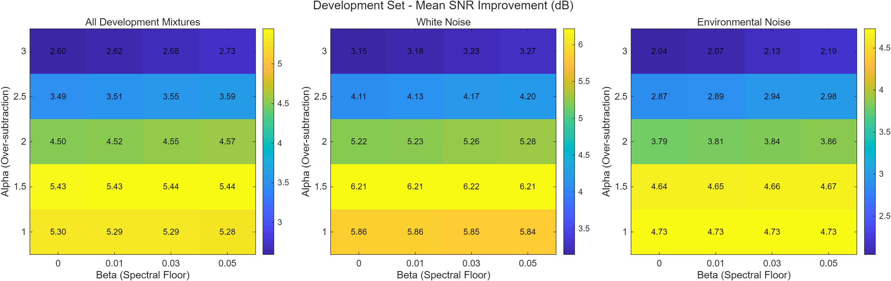
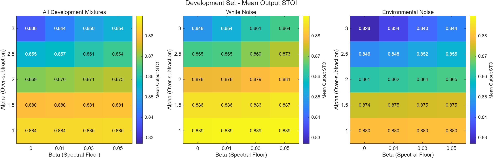
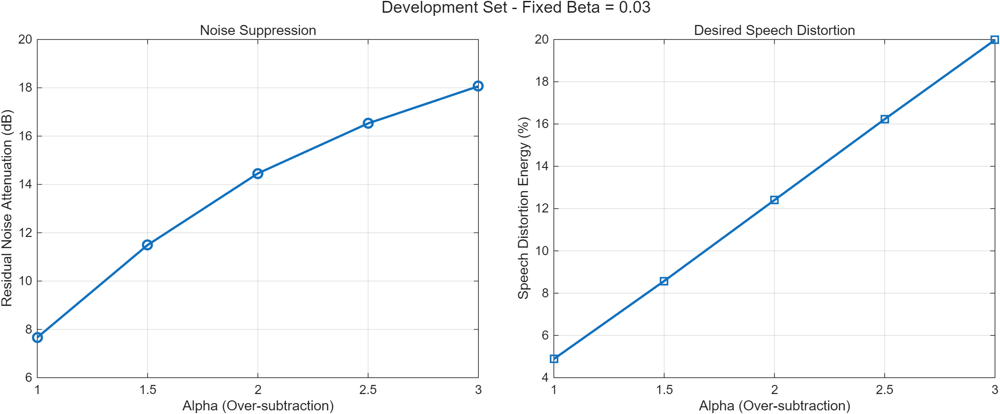
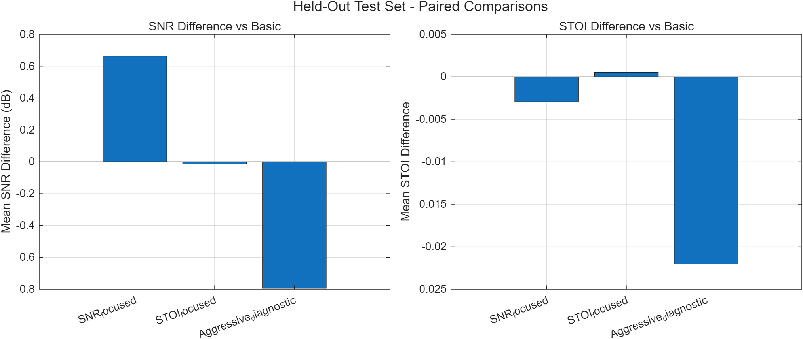
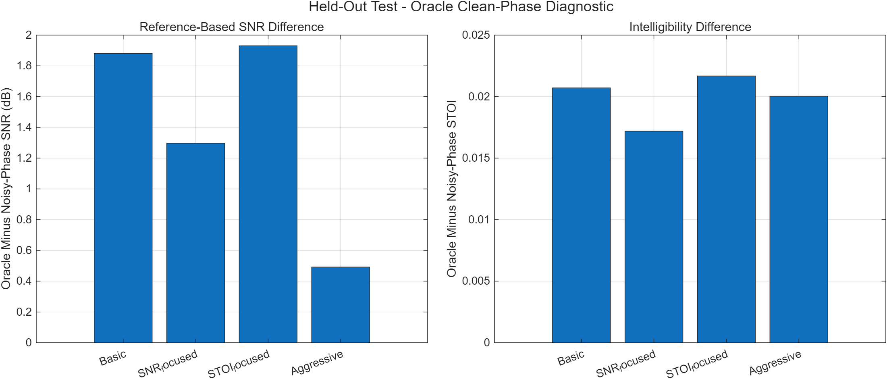
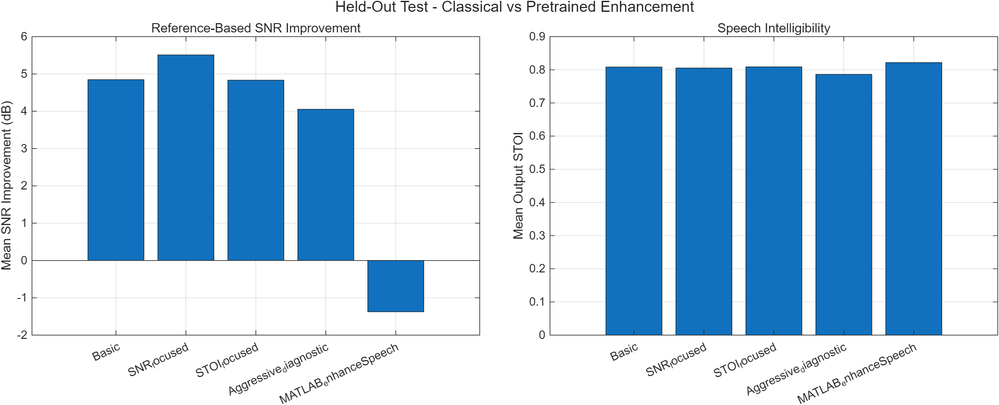

# Beyond SNR: Understanding the Artefacts and Limits of Spectral Subtraction

### ELEC5305 — Acoustics, Speech and Signal Processing

**Student:** Yuanyi Zhang  
**Student ID:** 550545073  
**Implementation:** MATLAB R2024a

---

## 1. Project Overview

This project investigates the limitations of Short-Time Fourier Transform (STFT)-based spectral subtraction for speech enhancement.

The main objective is to understand why stronger noise suppression does not always produce better speech enhancement results.

Instead of evaluating speech enhancement using only Signal-to-Noise Ratio (SNR), this study considers:

- Residual background noise
- Desired-speech attenuation
- Speech distortion
- Speech intelligibility (STOI)
- Phase-related reconstruction limitations

The project implements and evaluates basic and modified spectral subtraction algorithms using MATLAB.

Additional experiments investigate the impact of replacing noisy phase with oracle clean phase and compare classical approaches against MATLAB's pretrained `enhanceSpeech` model.

The pretrained MATLAB function is treated as an external comparison. It is not assumed to implement MP-SENet or an explicitly verified magnitude-and-phase enhancement architecture.

---

## 2. Research Questions

This project addresses four main research questions:

1. How do the over-subtraction factor (alpha) and spectral floor (beta) affect SNR improvement and STOI?

2. How much additional noise attenuation can be achieved before desired-speech distortion becomes significant?

3. How does replacing noisy phase with oracle clean phase affect speech reconstruction?

4. How do classical spectral subtraction methods compare with MATLAB's pretrained speech enhancement model?

---

## 3. Dataset and Experimental Design

### 3.1 Clean Speech Dataset

Clean speech recordings were selected from the LibriSpeech `test-clean` corpus.

Dataset specifications:

| Parameter | Description |
|---|---|
| Dataset | LibriSpeech test-clean |
| Total utterances | 12 |
| Total speakers | 6 |
| Sampling rate | 16 kHz |
| Channels | Mono |
| Utterance duration | Approximately 3–8 seconds |
| Development utterances | 4 |
| Test utterances | 8 |

The development and test sets contain different speakers to avoid speaker overlap during parameter selection.

### 3.2 Noise Conditions

Two noise conditions were used:

**White Noise**

Artificially generated white noise provides a controlled experimental condition.

**Environmental Noise**

A real environmental recording provides a time-varying, non-stationary noise condition.

The environmental recording was converted to 16 kHz mono for processing.

The recording is not publicly redistributed unless its source and reuse permissions are confirmed.

### 3.3 Input SNR Conditions

Three input SNR levels were evaluated:

- 0 dB
- 5 dB
- 10 dB

### 3.4 Dataset Split

| Dataset | Utterances | Noise Types | SNR Levels | Mixtures |
|---|---:|---:|---:|---:|
| Development | 4 | 2 | 3 | 24 |
| Test | 8 | 2 | 3 | 48 |
| Total | 12 | 2 | 3 | 72 |

The development set was used for parameter exploration and selection.

The held-out test set was reserved for final evaluation.

The 48 test mixtures are generated from eight underlying utterances, so they should not be treated as 48 statistically independent speech recordings.

---

## 4. Signal Processing Methods

### 4.1 STFT and ISTFT

All classical enhancement algorithms operate in the time-frequency domain.

The processing pipeline is:

1. Read noisy speech.
2. Perform STFT analysis.
3. Estimate the noise magnitude spectrum.
4. Apply spectral subtraction.
5. Retain the noisy phase.
6. Reconstruct the enhanced signal using inverse STFT.

The following parameters were used:

| Parameter | Value |
|---|---|
| Sampling rate | 16000 Hz |
| Window | Hann |
| Window length | 512 samples |
| Window duration | 32 ms |
| Hop size | 256 samples |
| Overlap | 50% |
| FFT size | 512 |
| Noise-only prefix | 0.5 seconds |

The custom STFT/ISTFT implementation was verified before the enhancement experiments.

A representative reconstruction test achieved:

- Reconstruction SNR: 185.07 dB
- Maximum absolute reconstruction error: approximately 2.22e-16

This confirms near-perfect reconstruction within numerical precision for the tested signal.

### 4.2 Basic Spectral Subtraction

Basic spectral subtraction estimates the clean speech magnitude by subtracting the estimated noise magnitude from the noisy speech magnitude.

The basic magnitude estimate is:

`|S_hat(m,k)| = max(|Y(m,k)| - |N_hat(k)|, 0)`

where:

- `Y(m,k)` is the noisy speech STFT.
- `N_hat(k)` is the estimated noise magnitude spectrum.
- `S_hat(m,k)` is the estimated clean speech STFT.

The noisy phase is retained during reconstruction.

This method serves as the baseline.

### 4.3 Modified Spectral Subtraction

The modified method introduces two adjustable parameters:

- Alpha: over-subtraction factor
- Beta: minimum spectral gain

The frequency-domain gain is:

`G(m,k) = min(1, max(1 - alpha*|N_hat(k)|/max(|Y(m,k)|,eps), beta))`

The enhanced spectrum is:

`S_hat(m,k) = G(m,k)*Y(m,k)`

The following parameter combinations were investigated:

**Alpha values:**

`[1.0, 1.5, 2.0, 2.5, 3.0]`

**Beta values:**

`[0.00, 0.01, 0.03, 0.05]`

This produces 20 parameter configurations.

Each configuration was evaluated on 24 development mixtures.

**Total parameter evaluations: 480**

---

## 5. Evaluation Metrics

### 5.1 Reference-Based SNR

The output reconstruction SNR is calculated using the clean reference signal:

`SNR_out = 10*log10(sum(s.^2)/sum((s_hat-s).^2))`

SNR improvement is defined as:

`SNR_improvement = SNR_out - SNR_in`

This metric includes both residual noise and changes to the desired speech waveform.

It should not be interpreted as a pure residual-noise measurement.

### 5.2 Short-Time Objective Intelligibility

STOI is used to estimate speech intelligibility.

MATLAB implementation:

```matlab
score = stoi(enhanced, clean, fs);
```

A higher STOI value generally indicates better predicted intelligibility.

However, STOI does not directly measure naturalness or subjective audio quality.

### 5.3 Qualitative Evaluation

Additional evaluation methods include:

- Spectrogram comparison
- Waveform comparison
- Residual-noise analysis
- Speech-distortion analysis
- Audio listening demonstrations

---

## 6. Development Set Results

### 6.1 Alpha-Beta Parameter Sweep

The development experiments demonstrated that stronger spectral subtraction does not consistently improve performance.

The basic configuration achieved:

- Alpha = 1.0
- Beta = 0.00
- Mean SNR improvement = 5.2961 dB

The highest development-set SNR improvement was obtained with:

- Alpha = 1.5
- Beta = 0.05
- Mean SNR improvement = 5.4419 dB

However, the highest STOI was obtained with:

- Alpha = 1.0
- Beta = 0.05
- Mean output STOI = 0.88465

These results demonstrate that the parameter settings preferred by SNR and STOI are not necessarily identical.

### 6.2 Noise Suppression and Speech Distortion

Increasing alpha produces stronger residual-noise suppression, but also increases desired-speech distortion.

At a fixed beta of 0.03:

| Alpha | Noise Attenuation (dB) | Speech Distortion Energy (%) |
|---|---:|---:|
| 1.0 | 7.66 | 4.88 |
| 1.5 | 11.49 | 8.57 |
| 2.0 | 14.46 | 12.40 |
| 2.5 | 16.53 | 16.23 |
| 3.0 | 18.07 | 19.98 |

The distortion percentage represents a signal-energy ratio relative to the original clean speech, not a subjective listening-quality percentage.

These measurements reveal a clear trade-off between residual-noise attenuation and desired-speech preservation.

---

## 7. Held-Out Test Evaluation

Four spectral subtraction configurations were selected using the development results.

Their parameters were fixed before the held-out test evaluation.

### 7.1 Final Classical Methods

| Method | Alpha | Beta |
|---|---:|---:|
| Basic | 1.0 | 0.00 |
| SNR-focused | 1.5 | 0.05 |
| STOI-focused | 1.0 | 0.05 |
| Aggressive diagnostic | 3.0 | 0.03 |

### 7.2 Final Test Results

All methods were evaluated on the same 48 held-out noisy mixtures.

| Method | Mean SNR Improvement (dB) | Mean Output STOI |
|---|---:|---:|
| Basic | 4.8472 | 0.80834 |
| SNR-focused | 5.5096 | 0.80541 |
| STOI-focused | 4.8330 | 0.80886 |
| Aggressive | 4.0528 | 0.78630 |
| MATLAB enhanceSpeech | -1.3739 | 0.82187 |

### 7.3 Paired Comparison

Relative to Basic:

**SNR-focused method**

- Mean SNR difference: +0.6624 dB
- Mean STOI difference: -0.00293
- Higher SNR in 41 of 48 test mixtures
- Higher STOI in 10 of 48 test mixtures

**STOI-focused method**

- Mean SNR difference: -0.0142 dB
- Mean STOI difference: +0.00052
- Higher SNR in 13 of 48 test mixtures
- Higher STOI in 41 of 48 test mixtures

**Aggressive method**

- Mean SNR difference: -0.7943 dB
- Mean STOI difference: -0.02204
- Higher SNR in 14 of 48 test mixtures
- Higher STOI in 2 of 48 test mixtures

The STOI-focused improvement is very small and should not be interpreted as a statistically established or practically significant intelligibility gain.

These results show that improved reconstruction SNR does not guarantee improved predicted intelligibility.

---

## 8. Oracle Clean-Phase Experiment

Traditional spectral subtraction generally retains the noisy phase.

To investigate this limitation, an oracle experiment replaces the noisy phase with the phase of the clean reference signal while keeping the estimated enhanced magnitude spectrum unchanged.

The experiment was conducted on all 48 held-out test mixtures.

### 8.1 Oracle Phase Results

For the Basic method:

| Metric | Noisy Phase | Oracle Clean Phase |
|---|---:|---:|
| Mean output SNR | 9.8472 dB | 11.7277 dB |
| Mean output STOI | 0.80834 | 0.82905 |

The oracle-phase substitution produced:

- Mean SNR difference: +1.8805 dB
- Mean STOI difference: +0.02071

Positive improvements were observed for all 48 test mixtures for both metrics in this controlled comparison.

The results suggest that retaining the noisy phase can limit reconstructed speech performance.

**Important:** Oracle clean phase is unavailable during practical speech enhancement. This experiment is a diagnostic study, not a deployable algorithm or a guaranteed mathematical performance bound.

---

## 9. Pretrained Speech Enhancement Comparison

A pretrained reference model was evaluated using MATLAB Audio Toolbox's `enhanceSpeech` function.

The model was used without additional training or parameter tuning.

### 9.1 Results

On the held-out test set:

- Mean SNR improvement: -1.3739 dB
- Mean output STOI: 0.82187

Relative to Basic:

- Mean SNR difference: -6.2211 dB
- Mean STOI difference: +0.01353

The pretrained method achieved:

- Higher reconstruction SNR in 3/48 mixtures
- Higher STOI in 38/48 mixtures

### 9.2 Interpretation

The pretrained model achieved the highest average STOI among the compared methods.

However, it produced a much lower reference-based reconstruction-SNR score.

The evaluation demonstrates that different performance metrics may rank enhancement approaches differently.

### 9.3 Output Validation

The pretrained model was checked using 24 development mixtures.

Results included:

- Zero-lag files: 24/24
- Maximum detected lag: 0 samples
- Mean enhanced/clean RMS ratio: 0.8871
- Mean improvement from oracle amplitude rescaling: 0.3397 dB

These checks did not identify a common fixed output delay or a simple gain mismatch sufficient to explain the reconstruction-SNR difference.

Oracle amplitude rescaling uses the clean reference and was employed only for diagnosis, not for official model scoring.

The pretrained reference should not be described as MP-SENet unless its actual architecture is independently verified.

---

## 10. Experimental Figures

### 10.1 Alpha-Beta SNR Parameter Sweep



### 10.2 Alpha-Beta STOI Parameter Sweep



### 10.3 Noise Suppression and Speech Distortion



### 10.4 Held-Out Test Paired Comparison



### 10.5 Oracle Phase Comparison



### 10.6 Classical Versus Pretrained Enhancement



Additional experimental figures are available in the `results/figures/` directory.

Detailed numerical results are available in `results/metrics/`.

---

## 11. Audio Demonstrations

Selected audio demonstrations are provided in:

`results/audio/`

The examples include:

- Clean speech
- Noisy speech
- Basic spectral subtraction
- SNR-focused spectral subtraction
- STOI-focused spectral subtraction
- Aggressive spectral subtraction
- Oracle clean-phase reconstruction
- MATLAB pretrained enhancement

Audio files should be compared at consistent playback levels.

Some environmental-noise examples may be retained locally if redistribution permission has not been confirmed.

---

## 12. Repository Structure

```text
elec5305-project-550545073/
|
|-- code/
|   |-- preprocessing/
|   |-- enhancement/
|
|-- results/
|   |-- figures/
|   |-- metrics/
|   |-- audio/
|
|-- data/
|   |-- clean/
|   |-- noise/
|   |-- mixtures/
|
|-- external/
|   |-- enhanceSpeechModel/
|
|-- README.md
|-- .gitignore
```

The `data` and `external` directories are maintained locally.

Large datasets and pretrained model weights are not included in the public repository.

---

## 13. Software Requirements

The project was developed using:

- MATLAB R2024a
- Audio Toolbox
- Signal Processing Toolbox
- LibriSpeech test-clean dataset
- MATLAB pretrained enhanceSpeech model files

The pretrained model files can be obtained from MathWorks:

https://ssd.mathworks.com/supportfiles/audio/enhanceSpeech.zip

Place the extracted files in the local model directory and add the required directory to the MATLAB path.

---

## 14. Reproduction Instructions

### Step 1: Prepare Speech Data

Download the LibriSpeech `test-clean` dataset.

Place the extracted dataset in the local clean-data directory.

### Step 2: Prepare Environmental Noise

Provide a suitable environmental-noise recording.

Convert it to 16 kHz mono using the provided preprocessing script.

### Step 3: Generate Noisy Mixtures

Run the MATLAB preprocessing scripts in the following order:

```text
select_clean_utterances.m
verify_clean_dataset.m
prepare_environmental_noise.m
check_environmental_noise.m
generate_mixtures.m
```

### Step 4: Validate STFT/ISTFT

Run:

```text
validate_stft_istft.m
```

### Step 5: Run Classical Enhancement

Run:

```text
demo_basic_spectral_subtraction.m
run_alpha_beta_sweep.m
run_stoi_evaluation.m
analyse_speech_noise_tradeoff.m
```

### Step 6: Run Held-Out Evaluation

Run:

```text
run_final_test_evaluation.m
```

### Step 7: Run Oracle Phase Analysis

Run:

```text
analyse_oracle_phase.m
demo_oracle_phase.m
```

### Step 8: Run Pretrained Model Comparison

Download the required pretrained model files.

Run:

```text
run_pretrained_model_comparison.m
validate_pretrained_model_outputs.m
```

### Step 9: Verify Final Results

Run:

```text
audit_final_results.m
```

The audit checks dataset separation, matched evaluations, metric consistency, summary consistency, and expected result files.

The scripts assume the repository's `code/preprocessing/` and `code/enhancement/` structure is preserved.

Shared MATLAB functions may need the enhancement directory added to the MATLAB search path.

### Reproducibility Limitations

Exact numerical reproduction requires the same clean speech files, environmental recording, mixture settings, and pretrained model files.

Substituting a different environmental-noise recording may reproduce the experimental procedure but not the identical numerical results.

The saved results have passed internal consistency checks. However, the full workflow has not yet been independently verified on a clean second computer.

---

## 15. Main Conclusions

The experiments support the following conclusions:

1. Increasing spectral subtraction strength reduces residual noise but can also increase desired-speech distortion.

2. A higher reference-based reconstruction SNR does not necessarily correspond to better predicted speech intelligibility.

3. The modified method can achieve a higher mean SNR while slightly reducing STOI.

4. Oracle clean-phase reconstruction improves both SNR and STOI in the controlled diagnostic experiments, suggesting that noisy-phase retention can limit performance.

5. The pretrained MATLAB enhancement model produces the highest mean STOI in this test, but its reference-based reconstruction SNR is considerably lower.

6. Speech enhancement should be evaluated using complementary measures rather than relying on a single SNR metric.

The study is limited by its small set of speakers and utterances, single environmental-noise recording, limited parameter grid, and absence of formal human listening trials.

Future work could investigate adaptive noise estimation, broader noise environments, more speakers, and additional perceptual metrics.

---

## 16. References

[1] S. F. Boll, "Suppression of acoustic noise in speech using spectral subtraction," IEEE Transactions on Acoustics, Speech, and Signal Processing, 1979.

[2] C. H. Taal, R. C. Hendriks, R. Heusdens, and J. Jensen, "An algorithm for intelligibility prediction of time-frequency weighted noisy speech," IEEE Transactions on Audio, Speech, and Language Processing, 2011.

[3] V. Panayotov, G. Chen, D. Povey, and S. Khudanpur, "LibriSpeech: An ASR corpus based on public domain audio books," ICASSP, 2015.

LibriSpeech Dataset: https://www.openslr.org/12

[4] MathWorks, "enhanceSpeech Documentation."

https://www.mathworks.com/help/audio/ref/enhancespeech.html

[5] MathWorks, "stoi Documentation."

https://www.mathworks.com/help/audio/ref/stoi.html

---

## 17. Project Status

**Core implementation:** Completed

**Development parameter evaluation:** Completed

**Held-out test evaluation:** Completed

**Oracle phase diagnostic:** Completed

**Pretrained model comparison:** Completed

**Final results audit:** Passed

**Final research report and video presentation:** In preparation
